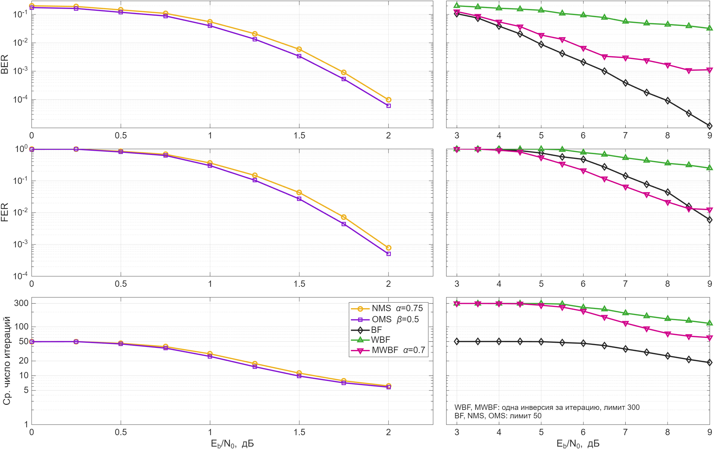
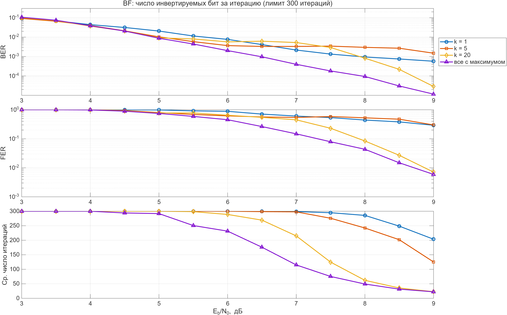
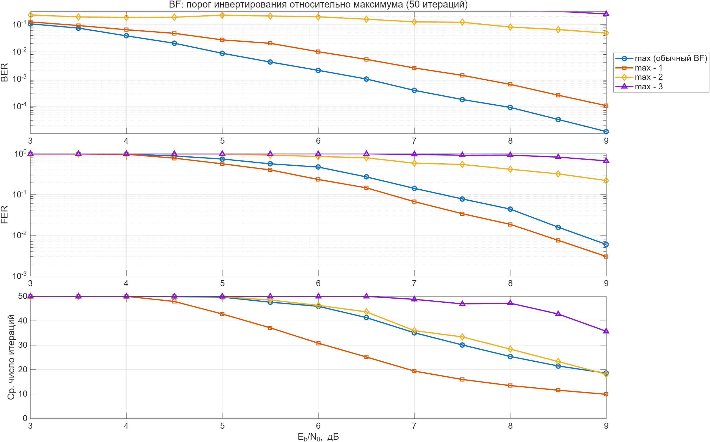
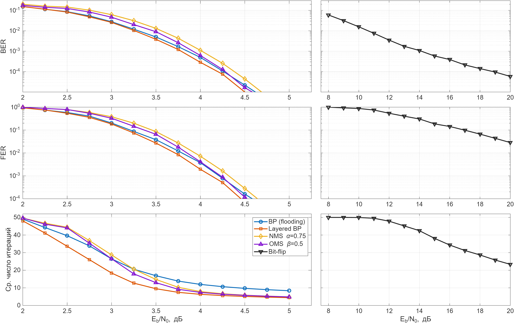

# dyse: bit-flip декодеры

5G NR BG2, Zc = 52, K = 520, R = 1/2, BPSK. Точка считается до 100 ошибочных кадров.

| Скрипт | Что считает |
|---|---|
| `run_bf_family.m` | BF, WBF, MWBF, NMS, OMS |
| `replot_bf_family_iters.m` | тот же график с логарифмической осью итераций |
| `run_bf_params.m` | число инвертируемых бит и порог |
| `run_rayleigh.m` | релеевский канал |

## 1. BF, WBF, MWBF, NMS, OMS

| Eb/N0 | FER BF | FER WBF | FER MWBF |
|---|---|---|---|
| 6 дБ | 0.47 | 0.77 | 0.21 |
| 8 дБ | 4.4e-2 | 0.35 | 2.2e-2 |
| 9 дБ | 6.0e-3 | 0.25 | 1.2e-2 |

Bit-flip проигрывает min-sum 6–7 дБ. MWBF лучший до ~8.5 дБ, WBF худший.

## 2а. Число инвертируемых бит за итерацию

| k | FER 8 дБ | FER 9 дБ | Итераций, 9 дБ |
|---|---|---|---|
| 1 | 0.44 | 0.29 | 204 |
| 5 | 0.53 | 0.30 | 125 |
| 20 | 8.4e-2 | 7.1e-3 | 23 |
| все с максимумом | 4.3e-2 | 5.9e-3 | 22 |

Чем меньше бит за итерацию, тем хуже.

## 2б. Порог инвертирования

| Порог | FER 8 дБ | FER 9 дБ | BER 9 дБ | Итераций, 9 дБ |
|---|---|---|---|---|
| max | 4.4e-2 | 6.0e-3 | 1.2e-5 | 18.6 |
| max − 1 | 1.9e-2 | 3.0e-3 | 1.1e-4 | 9.9 |
| max − 2 | 0.42 | 0.22 | — | — |
| max − 3 | 0.93 | 0.67 | — | — |

max − 1 даёт FER вдвое ниже, но BER в 10 раз выше. Фиксированный порог на этом коде не работает, FER = 1.

## 3. Релеевский канал

Независимые плоские замирания на символ, идеальная оценка канала.

| Декодер | AWGN | Рэлей | Потери |
|---|---|---|---|
| BP | 1.90 дБ | 4.21 дБ | 2.3 дБ |
| Layered BP | 1.81 дБ | 4.12 дБ | 2.3 дБ |
| NMS α = 0.75 | 1.97 дБ | 4.32 дБ | 2.35 дБ |
| OMS β = 0.5 | 1.92 дБ | 4.23 дБ | 2.3 дБ |

Eb/N0 при FER = 1e-3. BF даже при 20 дБ остаётся на FER 2.8e-2.
