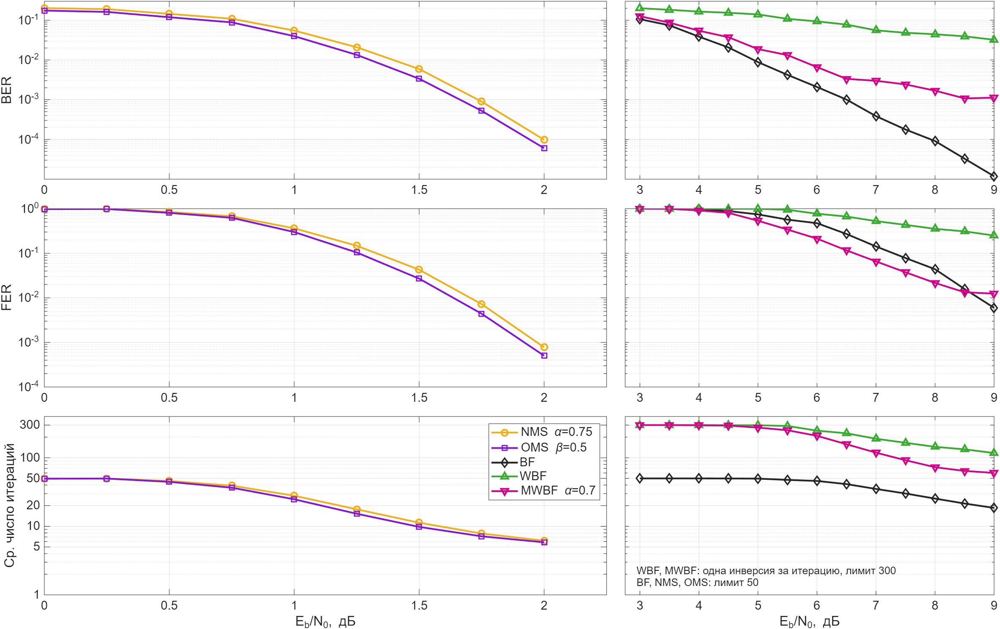
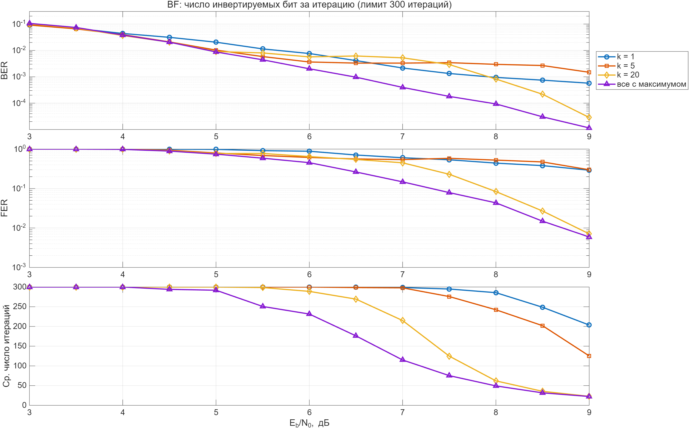
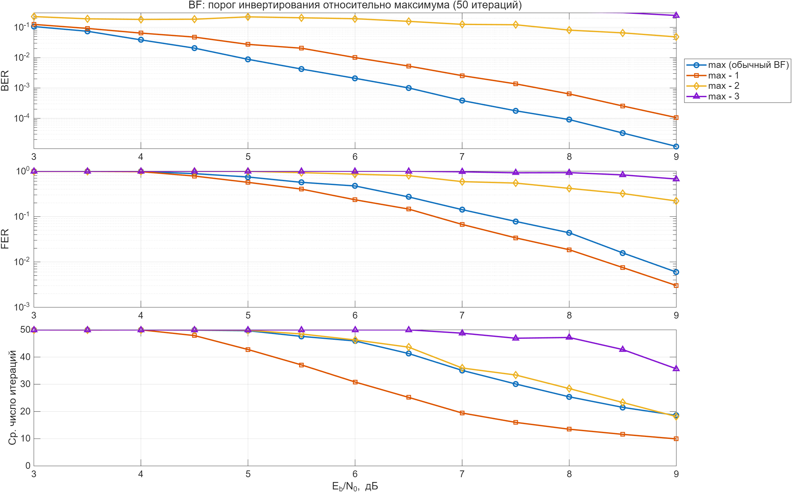
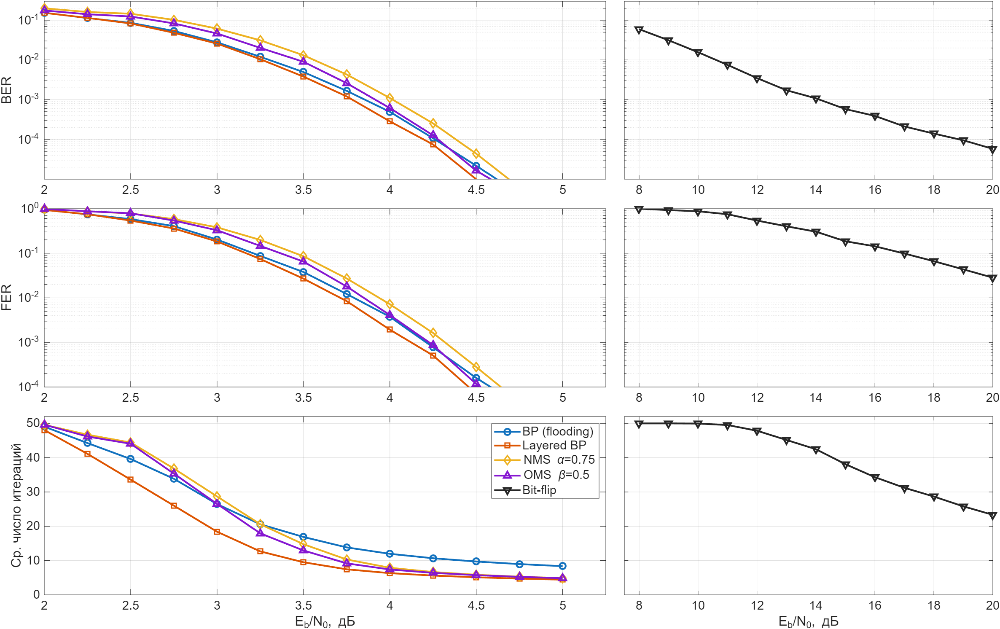

# dyse: bit-flip декодеры

5G NR BG2, Zc = 52, K = 520, R = 1/2, BPSK. Точка считается до 100 ошибочных кадров.

| Скрипт | Что считает |
|---|---|
| `run_bf_family.m` | BF, WBF, MWBF, NMS, OMS |
| `replot_bf_family_iters.m` | тот же график с логарифмической осью итераций |
| `run_bf_params.m` | число инвертируемых бит и порог |
| `run_rayleigh.m` | релеевский канал |
| `run_bf_preprocess.m` | BF после 1–10 итераций BP / layered BP / NMS |

## 1. BF, WBF, MWBF, NMS, OMS

| Eb/N0 | FER BF | FER WBF | FER MWBF |
|---|---|---|---|
| 6 дБ | 0.47 | 0.77 | 0.21 |
| 8 дБ | 4.4e-2 | 0.35 | 2.2e-2 |
| 9 дБ | 6.0e-3 | 0.25 | 1.2e-2 |

Bit-flip проигрывает min-sum 6–7 дБ. MWBF лучший до ~8.5 дБ, WBF худший.

## 2а. Число инвертируемых бит за итерацию

| k | FER 8 дБ | FER 9 дБ | Итераций, 9 дБ |
|---|---|---|---|
| 1 | 0.44 | 0.29 | 204 |
| 5 | 0.53 | 0.30 | 125 |
| 20 | 8.4e-2 | 7.1e-3 | 23 |
| все с максимумом | 4.3e-2 | 5.9e-3 | 22 |

Чем меньше бит за итерацию, тем хуже.

## 2б. Порог инвертирования

| Порог | FER 8 дБ | FER 9 дБ | BER 9 дБ | Итераций, 9 дБ |
|---|---|---|---|---|
| max | 4.4e-2 | 6.0e-3 | 1.2e-5 | 18.6 |
| max − 1 | 1.9e-2 | 3.0e-3 | 1.1e-4 | 9.9 |
| max − 2 | 0.42 | 0.22 | — | — |
| max − 3 | 0.93 | 0.67 | — | — |

max − 1 даёт FER вдвое ниже, но BER в 10 раз выше. Фиксированный порог на этом коде не работает, FER = 1.

## 3. Релеевский канал

Независимые плоские замирания на символ, идеальная оценка канала.

| Декодер | AWGN | Рэлей | Потери |
|---|---|---|---|
| BP | 1.90 дБ | 4.21 дБ | 2.3 дБ |
| Layered BP | 1.81 дБ | 4.12 дБ | 2.3 дБ |
| NMS α = 0.75 | 1.97 дБ | 4.32 дБ | 2.35 дБ |
| OMS β = 0.5 | 1.92 дБ | 4.23 дБ | 2.3 дБ |

Eb/N0 при FER = 1e-3. BF даже при 20 дБ остаётся на FER 2.8e-2.

## 4. BF после мягкой предобработки

`run_bf_preprocess.m`, `dyse_simulate_bf_pre.m`. Идея: перед BF прогнать
несколько итераций мягкого декодера (`ldpcDecode`, `OutputFormat='whole'`,
`DecisionType='soft'`), а его LLR подать в BF. BF использует только знак,
поэтому это эквивалентно жёсткому выходу мягкого декодера.

В таблице `BP n` без BF — это тот же мягкий этап, но без последующего BF;
так видно, что именно добавляет BF. Пробный прогон: 3–6 дБ, до 50 ошибочных
кадров, лимит 1e4 кадров. `0` — ошибок не наблюдалось (верхняя оценка
≈ 3e-4 при 1e4 кадрах).

| Конфигурация | 3 дБ | 3.5 дБ | 4 дБ | 4.5 дБ | 5 дБ | 6 дБ |
|---|---|---|---|---|---|---|
| BF | 1 | 1 | 0.984 | 0.875 | 0.719 | 0.430 |
| BP 2 + BF | 1 | 0.984 | 0.875 | 0.648 | 0.563 | 0.123 |
| BP 5 без BF | 0.458 | 0.120 | 1.45e-2 | 5e-4 | 0 | 0 |
| BP 5 + BF | 0.307 | 0.052 | 4.4e-3 | 3e-4 | 1e-4 | 0 |
| BP 10 без BF | 0 | 0 | 0 | 0 | 0 | 0 |
| Layered BP 5 + BF | 1e-4 | 0 | 0 | 0 | 0 | 0 |
| NMS 5 + BF | 1.8e-3 | 0 | 0 | 0 | 0 | 0 |

Среднее число итераций при 4 дБ: BF — 50, BP 2 + BF — 51, BP 5 + BF — 7.1,
BP 10 без BF — 10 (с досрочной остановкой меньше).

Выводы:

- Предобработка действительно улучшает BF: на 4 дБ BP 5 + BF даёт FER
  4.4e-3 против 0.98 у обычного BF, на 5 дБ — 1e-4 против 0.72.
- Но почти весь выигрыш даёт сам мягкий декодер, а не BF. BP 10 без BF
  уже при 3 дБ даёт 0 на 1e4 кадрах, тогда как BP 5 + BF при 3 дБ — 0.307
  и 32 итерации. На 6 дБ BP 3 без BF (0.0156) лучше, чем BP 2 + BF
  (0.123) при меньшем числе итераций.
- Когда мягкий этап уже сошёлся, BF не нужен. При 5 дБ BP 5 дал 0
  ошибочных кадров по информации, но 20 из 1e4 кадров имели верную
  информацию и ненулевой синдром; BF на одном из них испортил информацию
  (FER 1e-4). С `bfOnFail='channel'` такого регресса не было бы, но и
  пользы от BF нет.
- Проверка мягкого этапа: `ldpcDecode` с 5 и 10 итерациями совпадает с
  `nrLDPCDecode` (при 3 дБ BP 5: 0.458 против 0.445; BP 10: 0 против 0;
  при 6 дБ BP 2: 0.547 против 0.578).

Итог: для этого кода подход «несколько итераций BP, потом BF» не даёт
практического выигрыша. Если есть мягкий декодер, лучше добавить ему 1–2
итерации; BF после BP имеет смысл только как дешёвая добивка при жёстком
лимите на мягкие итерации.
