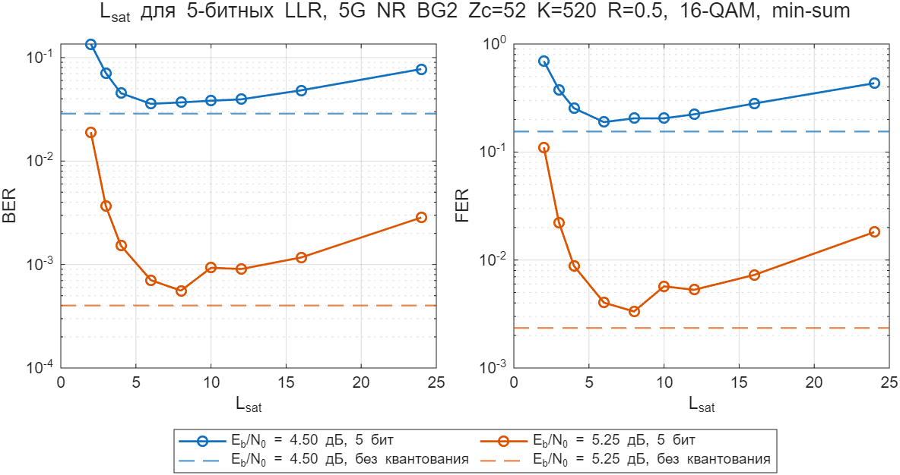
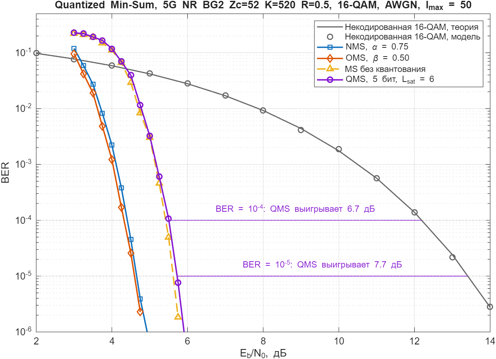
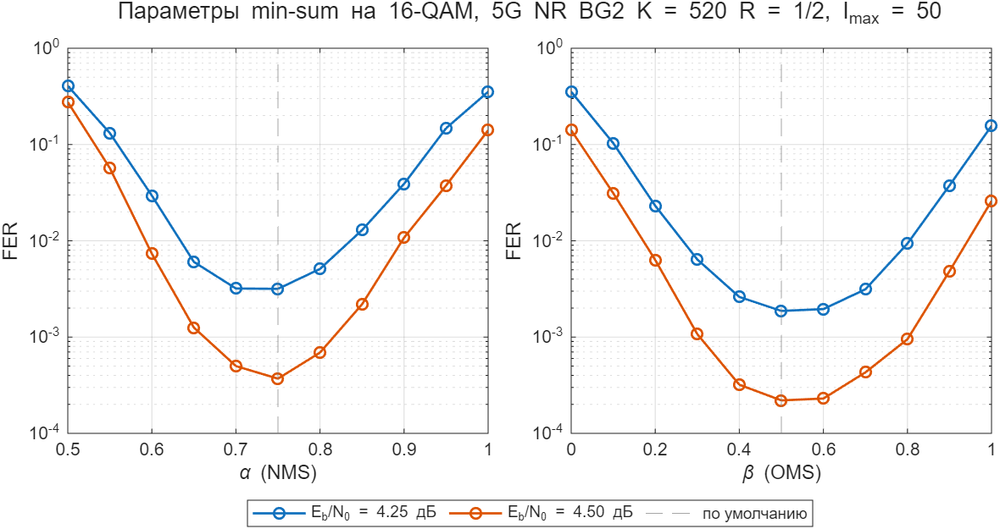

# matvey: квантование LLR

Quantized Min-Sum (QMS) на нашем 5G-коде. Алгоритм квантования взят из
task3 репозитория https://github.com/MobinKhatib/information-theory-ldpc-project
(там матрицы H_1008_504 и H_1056_176), считаем на 5G NR BG2, Zc = 52, K = 520, R = 1/2,
16-QAM, AWGN, I_max = 50, чтобы результаты были сравнимы с остальными.

QMS здесь, как в task3: LLR канала квантуются равномерно с насыщением
(B бит → уровни −Qmax..Qmax, Qmax = 2^(B−1) − 1, шаг L_sat/Qmax), затем обычный
min-sum (`nrLDPCDecode`, `'Normalized min-sum'`, α = 1, layered). Сообщения внутри
декодера не квантуются.

| Файл | Что делает |
|---|---|
| `quantize_llr.m` | квантователь LLR (порт `quantize_llr` из task3) |
| `simulate_quantized.m` | Монте-Карло как в `ldpc_simulate` + квантование LLR перед декодером, алгоритм `'min-sum'`, останов по `p.minBer`; без квантования покадрово совпадает с `ldpc_simulate` |
| `ebno_at_ber.m` | Eb/N0 при заданном BER (интерполяция log BER) |
| `run_lsat_sweep.m` | выбор L_sat для 5 бит |
| `run_qms_vs_nms_oms.m` | главный график: некодированная 16-QAM, NMS, OMS, MS, QMS 5 бит; кривые считаются параллельно (`parfor`) |
| `run_minsum_params_16qam.m` | подбор α (NMS) и β (OMS) на 16-QAM, как `run_e3_minsum_params` для BPSK |
| `plot_lsat_sweep.m`, `plot_qms_vs_nms_oms.m`, `plot_minsum_params_16qam.m` | графики из сохранённых `.mat` |
| `replot.m` | перерисовать все графики без пересчёта |

Результаты: `results/*.mat`, `results/*.png`, `results/qms_vs_nms_oms_gain.csv`.
Для пробного прогона в скрипте поставить `quick = true`.
Полный `run_qms_vs_nms_oms` идёт около 45 минут (4 воркера).

## Результаты

**Выбор L_sat** (5 бит, min-sum, 4,5 и 5,25 дБ; пунктир — min-sum без квантования).
Оптимум L_sat ≈ 6–8: при малом L_sat срезаются надёжные LLR, при большом слишком
грубый шаг. Взято L_sat = 6 (шаг 0,4), как и в task3.

**QMS против NMS, OMS и некодированной передачи.** NMS α = 0,75, OMS β = 0,5 (значения
проекта по умолчанию), QMS 5 бит, L_sat = 6. Некодированная 16-QAM — теория `berawgn`,
модель с ней совпадает.

| Кривая | Eb/N0 при BER 1e-4, дБ | Выигрыш, дБ | Eb/N0 при BER 1e-5, дБ | Выигрыш, дБ |
|---|---|---|---|---|
| Некодированная 16-QAM | 12,19 | — | 13,41 | — |
| NMS | 4,41 | 7,78 | 4,65 | 8,75 |
| OMS | 4,32 | 7,87 | 4,60 | 8,81 |
| MS без квантования | 5,42 | 6,77 | 5,62 | 7,79 |
| QMS, 5 бит | 5,51 | 6,68 | 5,72 | 7,68 |

Основные выводы — при BER 1e-4: там почти все опорные точки набраны на 69–101 ошибочном
кадре. Значения при 1e-5 менее надёжны (см. ниже).

- **Квантование входных LLR до 5 бит стоит ≈ 0,1 дБ при неквантованных сообщениях**
  (QMS против MS: 0,09 дБ при 1e-4). Это цена только квантования входа декодера, а не
  5-битного декодера целиком: в реальной реализации насыщаются и сообщения внутри
  декодера, и потери могут быть больше.
- **QMS проигрывает NMS ≈ 1,1 дБ и OMS ≈ 1,2 дБ** (при 1e-4). Почти весь проигрыш даёт
  сам min-sum без поправки (α = 1, β = 0): он завышает сообщения проверочных узлов, на
  16-QAM это стоит ~1 дБ. Квантование входа добавляет к этому только ≈ 0,1 дБ.
- **Выигрыш кодирования QMS: 6,7 дБ при BER 1e-4** (у NMS/OMS 7,8–7,9 дБ). При BER 1e-5
  оценка ≈ 7,7 дБ (у NMS/OMS ≈ 8,8 дБ).
- OMS чуть лучше NMS (0,05–0,09 дБ). α и β здесь — значения проекта по умолчанию,
  подобранные на BPSK; проверка на 16-QAM (ниже) показала, что они оптимальны и здесь.

Точка считается до 100 ошибочных кадров (лимит 3e5 кадров, ниже BER 1e-6 не считаем),
погрешность FER около ±20 %.

**Точность при BER 1e-5.** Значения при 1e-5 интерполируются к точкам, набранным на
лимите 3e5 кадров с малым числом ошибочных кадров:

| Кривая | Точка ниже BER 1e-5 | BER | Ошибочных кадров |
|---|---|---|---|
| NMS | 4,75 дБ | 3,90e-6 | 16 |
| OMS | 4,75 дБ | 2,28e-6 | 4 |
| MS | 5,75 дБ | 1,85e-6 | 4 |
| QMS | 5,75 дБ | 7,64e-6 | 14 |

Погрешность при 1e-5 — порядка ±0,1 дБ (оценка, не расчёт), поэтому разница
QMS − MS = 0,10 дБ при 1e-5 ненадёжна. При 1e-4 у QMS верхняя опорная точка (5,75 дБ)
тоже стоит на 14 кадрах, но значение 5,51 дБ почти совпадает с точкой 5,5 дБ, набранной
на 100 кадрах.

**Подбор α и β на 16-QAM** (4,25 и 4,5 дБ; до 100 ошибочных кадров, лимит 1e5 кадров).
β зависит от масштаба LLR, поэтому значения, подобранные на BPSK, стоило проверить на 16-QAM.
Минимум FER: α = 0,70–0,75 и β = 0,5–0,6, то есть значения по умолчанию (α = 0,75,
β = 0,5) оптимальны и здесь, и пересчитывать главный график не нужно. В своих оптимумах OMS
лучше NMS: FER 1,9e-3 против 3,2e-3 при 4,25 дБ (по 100 ошибочных кадров) и 2,2e-4 против
3,7e-4 при 4,5 дБ (22 и 37 кадров). Это подтверждает, что OMS чуть лучше NMS.

**Перемежитель.** Перед 16-QAM нет битового перемежителя: биты кодового слова идут на
символы подряд, как и в общем `ldpc_simulate`. Сравнение декодеров между собой это не
ломает, но абсолютные пороги могут отличаться от настоящего 5G.

## Дальше

Квантование 3/4/5 бит для NMS и OMS — к следующему созвону, **только входных LLR**, как
здесь: квантуются LLR канала, декодер — `nrLDPCDecode` с неквантованными сообщениями.
Своего min-sum декодера в репозитории нет, а `nrLDPCDecode` не умеет квантовать сообщения.
Для такой модели ожидание: квантованные NMS/OMS почти полностью уберут проигрыш ~1 дБ
относительно QMS, потому что его даёт отсутствие поправки, а не квантование. Настоящий
5-битный декодер (с насыщением сообщений) — отдельный шаг, нужен свой декодер.
