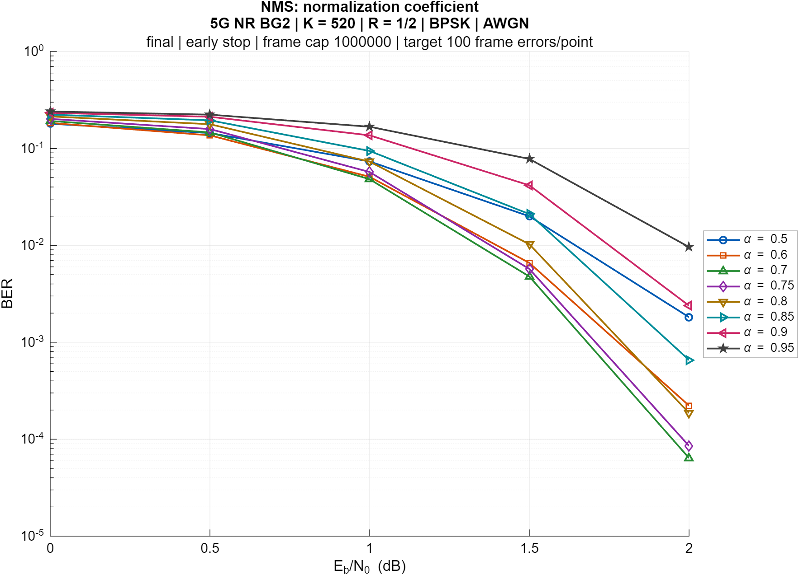
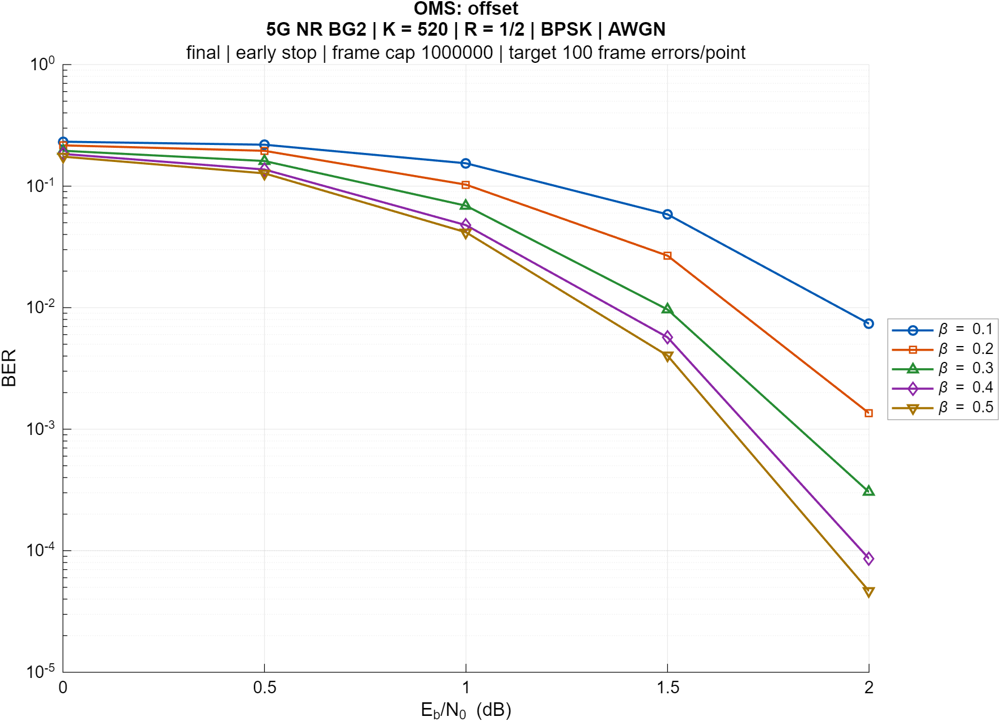
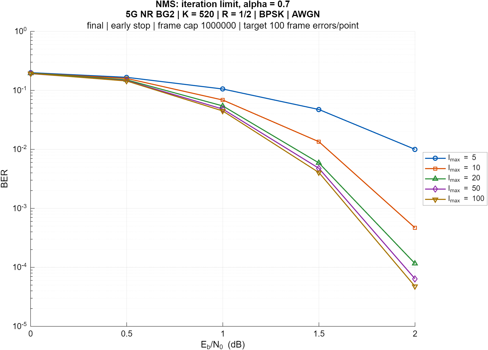
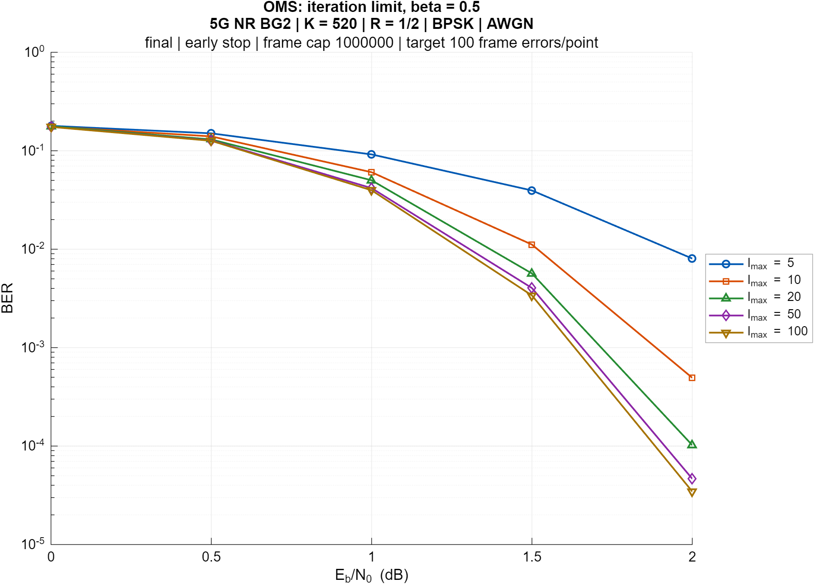

# Параметры NMS и OMS: результаты моделирования

Расчёты выполнены 5 ноября 2026 года в MATLAB R2025b. Использованы общая
модель `ldpc_simulate` и готовые декодеры `nrLDPCDecode`. Общие функции
проекта не изменялись.

## Условия

5G NR LDPC BG2, Zc=52, K=520, R=1/2, E=1040, BPSK, AWGN.
Eb/N0 = 0:0.5:2 дБ. При подборе параметров maxIter=50. Остановка декодера
досрочная, по выполнению проверок; seed=1.

На точку: цель 100 ошибочных кадров или максимум 1 000 000 кадров.
Все 115 точек набрали целевую статистику; фактически потребовалось
от 128 до 355 008 кадров. Миллион является верхним пределом.

Предварительные расчёты имели лимит 20 000 кадров. Если каждая точка
кривой уже набрала 100 ошибочных кадров при полностью совпадающих
настройках, кроме лимита, такая кривая использована повторно. Исходные
параметры и признаки переноса сохранены в MAT. Подробности — в README.

## 1. Нормализация NMS

Проверены α = 0.50, 0.60, 0.70, 0.75, 0.80, 0.85, 0.90, 0.95.
По минимуму геометрического среднего BER по пяти заданным Eb/N0 выбран
**α=0.70**. Это также минимальная измеренная BER при 1, 1.5 и 2 дБ.
При 0 дБ минимальна точечная оценка для α=0.50, при 0.5 дБ — для α=0.60.

## 2. Смещение OMS

Проверены β = 0.1, 0.2, 0.3, 0.4, 0.5. Выбран **β=0.5**:
минимальная измеренная BER во всех пяти точках и минимальное
геометрическое среднее. Это лучший вариант среди проверенных значений;
диапазон выше 0.5 не исследовался.

## 3. Число итераций

Для NMS зафиксирован α=0.70, для OMS β=0.5. Проверены пределы
5, 10, 20, 50, 100 итераций.

| maxIter | BER NMS при 2 дБ | BER OMS при 2 дБ |
|---:|---:|---:|
| 5 | 1.00060e-2 | 8.03786e-3 |
| 10 | 4.67936e-4 | 4.93941e-4 |
| 20 | 1.15874e-4 | 1.02241e-4 |
| 50 | 6.39279e-5 | 4.65780e-5 |
| 100 | 4.76530e-5 | 3.45929e-5 |

В области перехода к низкой BER увеличение числа итераций даёт
улучшение с убывающей отдачей. При 2 дБ переход 50→100 уменьшил измеренную
BER примерно на 25.5% для NMS и 25.7% для OMS. Поэтому утверждать полное
насыщение после 50 нельзя.

Средние фактические итерации при 2 дБ:
NMS — 6.361 при пределе 50 и 6.404 при 100;
OMS — 5.844 и 5.861 соответственно. Небольшое среднее не означает,
что такого же малого максимума достаточно для редких трудных кадров.

## Файлы и проверка

В `results/final/` для каждого исследования сохранены:

- `.mat` с полными результатами и настройками;
- `*_ber.png` — основной график;
- `*_fer.png` и `*_avgIter.png` — дополнительные метрики;
- `*_counts.csv` — BER, FER, итерации и исходные счётчики ошибок.

В MATLAB из папки эксперимента:

~~~matlab
validate_maxim_results('final') % проверка готовых файлов, без моделирования
run_all_maxim('trial')         % пробный режим
run_all_maxim('final')         % финальный режим с продолжением готовых кривых
~~~

Проверены все 23 кривые, 115 точек, настройки, формулы BER/FER по
счётчикам и пределы итераций. Анализатор MATLAB: 0 сообщений.

## Ограничения

Выводы относятся к заданным коду, каналу и сетке. Критерий выбора —
геометрическое среднее BER, не доказательство универсального оптимума.
Выполнен один воспроизводимый набор случайных последовательностей.
Ошибки битов внутри кадра зависимы, поэтому небольшие различия нельзя
автоматически объявлять статистически значимыми.

Сохранено упрощённое согласование скорости исходной модели без
filler-бит и битового перемежения. Время декодирования не использовано
для сравнения быстродействия: часть серий считалась параллельно.
