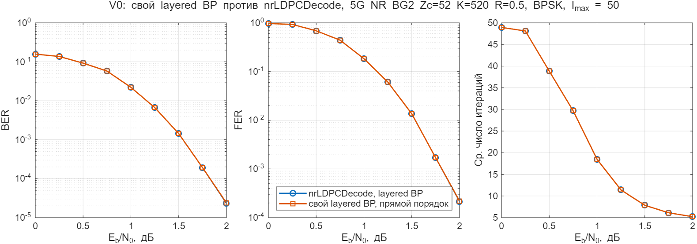
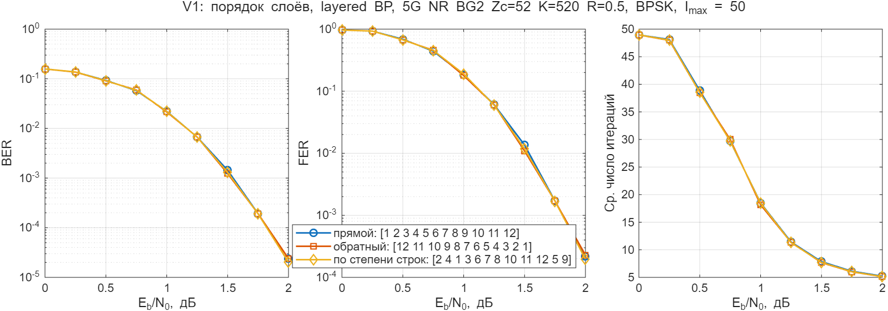
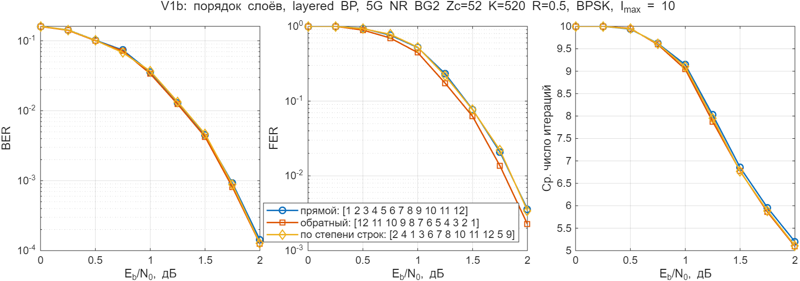
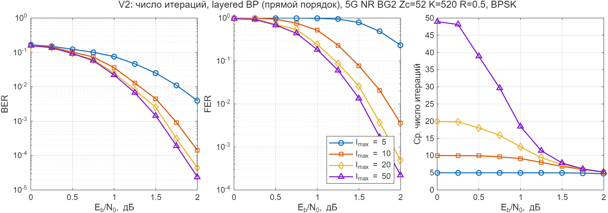

# vova: layered BP

Свой layered BP декодер (sum-product) с заданным порядком обхода слоёв.
Код 5G NR BG2, Zc = 52, K = 520, R = 1/2, BPSK, AWGN.

| Файл | Что делает |
|---|---|
| `vova_layered_bp_decode.m` | декодер: H из `nr_ldpc_pcm`, слой = Zc строк H, порядок слоёв параметром |
| `vova_layer_order.m` | порядки: `forward`, `reverse`, `degree` (от большей степени строки к меньшей), `degree-asc` |
| `vova_simulate.m` | Монте-Карло как в `ldpc_simulate`, но со своим декодером; `p.compareRef = true` дополнительно декодирует теми же кадрами `nrLDPCDecode` layered |
| `run_v0_check.m` | сверка с `nrLDPCDecode` (прямой порядок): кривые и число кадров с разными решениями |
| `run_v1_layer_order.m` | порядок слоёв: прямой, обратный, по степени строк |
| `run_v1b_layer_order_10it.m` | то же при I_max = 10 |
| `run_v2_iterations.m` | число итераций 5, 10, 20, 50 |
| `replot_light.m` | перерисовать сохранённые результаты в светлой теме без пересчёта |

Результаты: `results/*.mat`, `results/*.png`.
Для пробного прогона в скрипте поставить `quick = true`.

## Результаты

**V0. Сверка с `nrLDPCDecode`** (прямой порядок, I_max = 50). Кривые совпадают. Решения расходятся на 6 кадрах из ~523 тыс., все при 1,75–2 дБ; до 1,5 дБ совпадение покадровое, включая число итераций.

**V1. Порядок слоёв, I_max = 50.** Прямой, обратный и по степени строк практически не отличаются: разница по FER в пределах статистики, по среднему числу итераций около 2 %.

**V1b. Порядок слоёв, I_max = 10.** Обратный порядок лучше: FER в 1,2–1,6 раза ниже, чем у прямого (около 0,05–0,1 дБ). Порядок по степени строк совпадает с прямым.

| Eb/N0, дБ | FER прямой | FER обратный | FER по степени |
|---|---|---|---|
| 1,00 | 5,21e-1 | 4,45e-1 | 5,26e-1 |
| 1,50 | 7,74e-2 | 6,25e-2 | 7,66e-2 |
| 2,00 | 3,58e-3 | 2,26e-3 | 3,42e-3 |

**V2. Число итераций** (прямой порядок). 5 итераций почти не исправляют ошибки (FER ≈ 2e-1 при 2 дБ), 10 итераций проигрывают 50 около 0,3 дБ, 20 итераций около 0,1 дБ. В области низкого FER кадры сходятся в среднем за 5–6 итераций.

Точка считается до 100 ошибочных кадров (лимит 1e6 кадров), погрешность FER около ±20 %.
